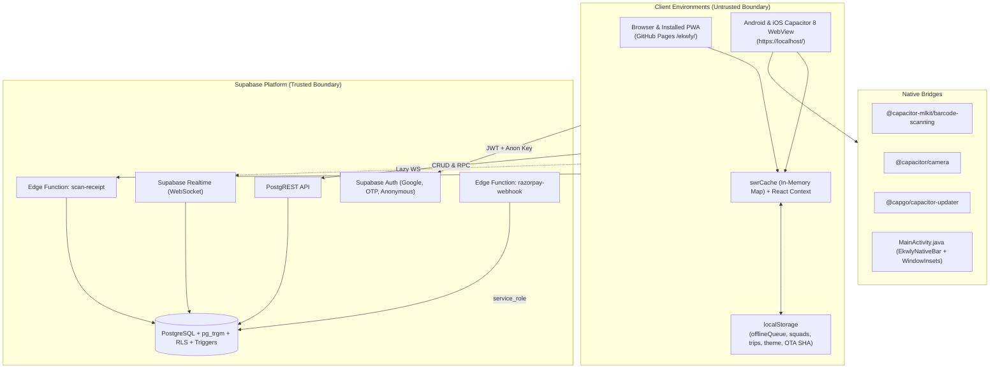

# Ekwly — System Architecture Overview

> **Status:** Current Verified State (Post-Audit Baseline)
> **App ID:** `com.ekwly.app` (`v1.0.0`, `versionCode: 1`)
> **Core Constraint:** ₹0 Hosting & Operational Cost Architecture + 60Hz–240Hz Frame-Rate Budget

---

## 1. Purpose & Core Capabilities

Ekwly is a cross-platform (Web PWA, Android, iOS) collaborative dining bill-splitting, Indian POS multi-bracket tax routing, and social expense-ledger application.

- **Solo-Host First & Live Multiplayer:** Supports single-device "Designated Treasurer" workflows with dormant WebSockets, scaling on demand to live QR multiplayer (`useSessionSync.ts`).
- **Indian POS Multi-Rate Taxation & 3-Layer Discounts:** Models Food GST (5%), Alcohol VAT, Sin/Tobacco GST, cascading vs. independent Service Charges, and simultaneous Item + Pre-Tax + Post-Tax discounts (`src/lib/mathEngine.ts`).
- **AI Magic Bill Scanner:** Client-side `<canvas>` receipt compression (`MagicScanner.tsx`) backed by a zero-storage Supabase Edge Function (`supabase/functions/scan-receipt/index.ts`).
- **UPI & Shareable Exports:** Generates NPCI `upi://pay` deep links, host-screen dynamic UPI QRs (`DebtMatrix.tsx`), 28-tooth skeuomorphic Canvas receipt & 1-on-1 nudge PNG cards (`src/lib/bentoReceipt.ts`), jsPDF statements (`src/lib/pdf.ts`), and Splitwise CSV imports (`src/lib/splitwiseCsv.ts`).
- **Social & Ledger:** Bidirectional friend connections (`Friends.tsx`), local Saved Squads, local Multi-Bill Trip Folders (`Home.tsx`), and bilaterally netted Global Ledger (`Ledger.tsx`).

---

## 2. Verified Technology Stack (`package.json`)

| Layer                 | Technology & Version                                                                                                                                 | Notes                                                                                                         |
| :-------------------- | :--------------------------------------------------------------------------------------------------------------------------------------------------- | :------------------------------------------------------------------------------------------------------------ |
| **Frontend Shell**    | Astro `^7.4.13` (`output: 'static'`) + React `^19.3.1`                                                                                               | `index.astro` mounts `<AppRouter client:only="react"/>`; legal pages are static `.astro` routes               |
| **Styling & Motion**  | Tailwind CSS `^4.3.5` (`@tailwindcss/vite`) + Framer Motion `^13.5.1` + Lucide React `^1.77.0`                                                       | CSS custom property tokens in `src/styles/theme.css`                                                          |
| **Backend Platform**  | Supabase (`@supabase/supabase-js ^2.119.2`)                                                                                                          | PostgreSQL + RLS + Realtime + Auth (Google, Email OTP, Anonymous) + Deno Edge Functions                       |
| **Native Wrapper**    | Capacitor `^8.6.2` (`android`, `ios`, `app ^8.1.2`, `camera ^8.2.6`, `@capacitor-mlkit/barcode-scanning ^8.2.2`, `@capgo/capacitor-updater ^8.54.2`) | TLS enforced (`cleartext: false`); Android Gradle `8.14.3` / AGP `8.13.0` / SDK `36` / minSdk `24` / JDK `21` |
| **Exports & QR**      | `jspdf ^4.2.1`, `jspdf-autotable ^5.0.9`, `react-qr-code ^2.2.0`, `html5-qrcode ^2.3.8`                                                              | Dynamic ESM imports for `jspdf` and `html5-qrcode`                                                            |
| **Tooling & Testing** | Node `24` (`.nvmrc`), `pnpm` v12, TypeScript `^6.0.0`, Vitest `^5.1.1`, ESLint `10` (`eslint.config.mjs`), `@astrojs/check`, Prettier `^3.10.1`      | 14 unit tests across 3 suites (`mathEngine`, `splitwiseCsv`, `utils`)                                         |

---

## 3. System & Trust Boundary Architecture

---

## 4. Application Module Boundaries (Current State)

- **`src/components/AppRouter.tsx`:** Root SPA router managing 8 views (`auth`, `home`, `lobby`, `session`, `profile`, `friends`, `ledger`, `analytics`) via `window.history.pushState`/`popstate`, `React.lazy` route splitting, URL query deep links (`?add_friend=`, `?s=&p=`), and Capacitor hardware back handling.
- **`src/components/ActiveSession.tsx` & `src/components/session/*`:** 2-tab session orchestrator (`1. Receipt & Split` / `2. Settle & Collect`) portaling its tab switcher into `#ekwly-header-subnav`, wrapping `ReceiptWorkbench`, `WorkbenchRuleDrawers`, `MagicScanner`, `Payments`, and `DebtMatrix`.
- **`src/lib/SessionContext.tsx` + `src/lib/session/*`:** Combines `useSessionSync.ts` (parallel 7-query load + conditional Realtime subscription), `useSessionMutations.ts` (optimistic React updates + Supabase writes), and `offlineQueue.ts` (`localStorage` queue).
- **`src/lib/` Domain & Export Engines:** Pure calculation/parsing modules (`mathEngine.ts`, `splitwiseCsv.ts`, `utils.ts`) plus client-side renderers (`bentoReceipt.ts`, `pdf.ts`) and checkout helper (`razorpay.ts`).
- **`src/pages/` & `src/layouts/LegalLayout.astro`:** Static Astro entrypoints (`index.astro`, `privacy.astro`, `terms.astro`, `refunds.astro`, `delete-account.astro`).

---

## 5. Build, CI/CD & Deployment Architecture

- **Web Deployment (`.github/workflows/deploy.yml`):** Runs on push to `main` or manual dispatch (`pnpm install --frozen-lockfile` -> `pnpm test` -> `pnpm run build` -> packages `ota-bundle.zip` + `version.json` -> deploys `./dist` to GitHub Pages).
- **Native Build (`.github/workflows/build-native.yml` & `scripts/configure-native.mjs`):** Manual `workflow_dispatch` only. Builds Astro with `CAPACITOR_BUILD=true`, syncs Capacitor Android/iOS, patches Gradle/AGP/SDK/Manifest/Info.plist/Vector Adaptive Icons, and produces Android APK/AAB or unsigned iOS IPA.
- **Static Hosting Constraint:** No Astro SSR runtime exists in production. All privileged operations must execute inside PostgreSQL (`RLS` / `SECURITY DEFINER` RPCs / triggers) or Supabase Edge Functions.

---

## 6. Verified Current Limitations (Tracked in `docs/roadmap/audit-findings.md`)

1. **OTA Base-Path Mismatch (`AUD-16`):** `deploy.yml` currently zips the `/ekwly/` web build into `ota-bundle.zip` for root `/` Capacitor installs (Stage 1 fix).
2. **Capacitor Workbox Conflict (`AUD-26`):** `astro.config.mjs` enables `AstroPWA` unconditionally even during `CAPACITOR_BUILD=true` (Stage 1 fix).
3. **Native Auth Redirects (`AUD-25`):** `supabase/config.toml` has `additional_redirect_urls = []`, blocking native OAuth/Magic Link callbacks (Stage 4 fix).
4. **Security & RLS Gaps (`AUD-01`–`AUD-05`, `AUD-24`):** Webhook pricing/idempotency, `scan-receipt` anonymous abuse/quota race, permissive room RLS, and missing Realtime publication entries are scheduled for Stages 1–2.
