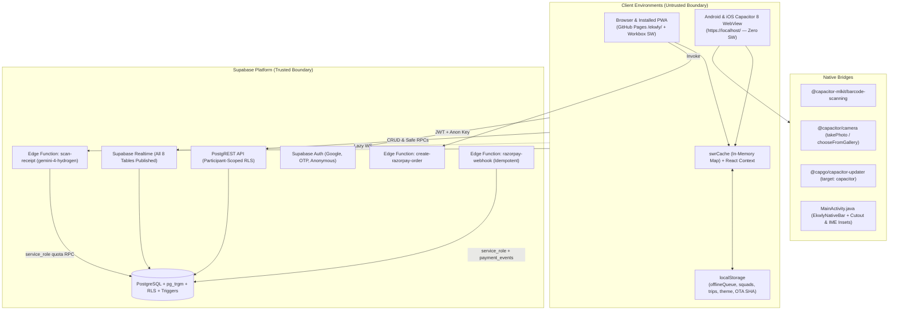

# Ekwly — System Architecture Overview

> **Status:** Post-Stage 2 Verified State (November 25, 2026)
> **App ID:** `com.ekwly.app` (`v1.0.0`, `versionCode: 10000`)
> **Core Constraint:** ₹0 Hosting & Operational Cost Architecture + 60Hz–240Hz Frame-Rate Budget

---

## 1. Purpose & Core Capabilities

Ekwly is a cross-platform (Web PWA, Android, iOS) collaborative dining bill-splitting, Indian POS multi-bracket tax routing, and social expense-ledger application.

- **Solo-Host First & Live Multiplayer:** Supports single-device "Designated Treasurer" workflows with dormant WebSockets, scaling on demand to live QR multiplayer (`useSessionSync.ts`) backed by all 8 Realtime-enabled tables.
- **Indian POS Multi-Rate Taxation & 3-Layer Discounts:** Models Food GST (5%), Alcohol VAT, Sin/Tobacco GST, cascading vs. independent Service Charges, and simultaneous Item + Pre-Tax + Post-Tax discounts (`src/lib/mathEngine.ts`).
- **AI Magic Bill Scanner (`gemini-4-hydrogen`):** Client-side `<canvas>` short-edge thermal receipt optimization (`MagicScanner.tsx`) backed by a zero-storage Supabase Edge Function (`supabase/functions/scan-receipt/index.ts`) featuring venue DB priors, CGST/SGST reconciliation, deterministic POS math verification, and automated Pass 2 self-correction.
- **UPI & Shareable Exports:** Generates NPCI `upi://pay` deep links, host-screen dynamic UPI QRs (`DebtMatrix.tsx`), 28-tooth skeuomorphic Canvas receipt & 1-on-1 nudge PNG cards (`src/lib/bentoReceipt.ts`), jsPDF statements (`src/lib/pdf.ts`), and Splitwise CSV imports (`src/lib/splitwiseCsv.ts`).
- **Social & Ledger:** Bidirectional friend connections (`Friends.tsx`), local Saved Squads, local Multi-Bill Trip Folders (`Home.tsx`), and bilaterally netted Global Ledger (`Ledger.tsx`).

---

## 2. Verified Technology Stack (`package.json`)

| Layer                 | Technology & Version                                                                                                                                 | Notes                                                                                                                                                                      |
| :-------------------- | :--------------------------------------------------------------------------------------------------------------------------------------------------- | :------------------------------------------------------------------------------------------------------------------------------------------------------------------------- |
| **Frontend Shell**    | Astro `^7.4.13` (`output: 'static'`) + React `^19.3.1`                                                                                               | `index.astro` mounts `<AppRouter client:only="react"/>`; legal pages are static `.astro` routes                                                                            |
| **Styling & Motion**  | Tailwind CSS `^4.3.5` (`@tailwindcss/vite`) + Framer Motion `^13.5.1` + Lucide React `^1.77.0`                                                       | CSS custom property tokens in `src/styles/theme.css`                                                                                                                       |
| **Backend Platform**  | Supabase (`@supabase/supabase-js ^2.119.2`)                                                                                                          | PostgreSQL + Participant-Scoped RLS + Realtime + Auth (Google, Email OTP, Anonymous) + 3 Deno Edge Functions (`scan-receipt`, `create-razorpay-order`, `razorpay-webhook`) |
| **Native Wrapper**    | Capacitor `^8.6.2` (`android`, `ios`, `app ^8.1.2`, `camera ^8.2.6`, `@capacitor-mlkit/barcode-scanning ^8.2.2`, `@capgo/capacitor-updater ^8.54.2`) | TLS enforced (`cleartext: false`); Android Gradle `8.14.3` / AGP `8.13.0` / SDK `36` / minSdk `24` / JDK `21`; iOS deployment `15.0`                                       |
| **Exports & QR**      | `jspdf ^4.2.1`, `jspdf-autotable ^5.0.9`, `react-qr-code ^2.2.0`, `html5-qrcode ^2.3.8`                                                              | Dynamic ESM imports for `jspdf` and `html5-qrcode`                                                                                                                         |
| **Tooling & Testing** | Node `24` (`.nvmrc`), `pnpm` v12, TypeScript `^6.0.3`, Vitest `^5.1.1`, ESLint `10` (`eslint.config.mjs`), `@astrojs/check`, Prettier `^3.10.1`      | 14 unit tests across 3 suites; 0 `astro check` errors/hints; 0 ESLint errors                                                                                               |

---

## 3. System & Trust Boundary Architecture

---

## 4. Build, CI/CD & Deployment Architecture

- **Web & Native OTA Pipeline (`.github/workflows/deploy.yml`):** On push to `main`, runs `pnpm test`, `pnpm check`, and `pnpm lint`; builds a dedicated `CAPACITOR_BUILD=true` root `/` bundle (asserting zero `/ekwly/_astro/` paths and zero `sw.js`) zipped into `dist/ota-bundle.zip` with a SHA-256 `dist/version.json` (`target: "capacitor"`); then builds the `/ekwly/` Web PWA bundle and deploys `./dist` to GitHub Pages.
- **Native Build (`.github/workflows/build-native.yml` & `scripts/configure-native.mjs`):** Manual `workflow_dispatch` or local CLI (`node scripts/configure-native.mjs doctor|patch|keygen|icons|apk-debug|apk-release|aab-release`). Dynamically syncs `package.json` version and `capacitor.config.json` app metadata into Android and iOS projects and outputs signed artifacts into gitignored `dist/native/`.

---

## 5. Remaining Planned Engineering Work (Stages 3–5)

1. **Stage 3 (Reliability & Math):** Fix `mathEngine` edge cases (`AUD-27`), `AppRouter` stale closure & native listener cleanup (`AUD-19`), `ActiveSession` creation race & `'tx-1'` fallback (`AUD-18`), transactional `offlineQueue` & mutation rollbacks (`AUD-07`), `Ledger` auto-settle loop (`AUD-29`), `Home`/`Profile` UX (`AUD-30`), and `LegalLayout`/`privacy.astro` path bugs (`AUD-08`).
2. **Stage 4 (Native Runtime & Store Compliance):** Native OAuth/OTP deep-link callback handler (`AUD-25`), `@capacitor/filesystem` + `@capacitor/share` native exports (`AUD-28`), and Play Billing / StoreKit 2 IAP (`AUD-09`).
3. **Stage 5 (Performance, A11y & Maintainability):** SQL indexes & server-side Analytics/Friends RPCs (`AUD-13`, `AUD-22`), WCAG AA polish & Inter font (`AUD-14`, `AUD-31`, `AUD-33`), generated `database.types.ts`, TanStack Query, and monolith decomposition (`AUD-15`).
